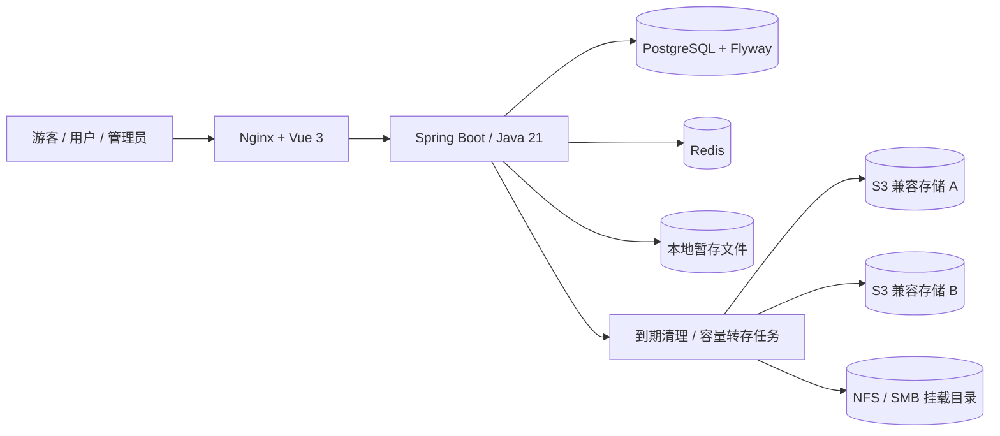

# 架构与数据生命周期

## 模块

- `auth`：BCrypt 密码、JWT 签发校验、HttpOnly Cookie、Redis 限流及令牌撤销、首次管理员创建。
- `files`：上传、所有权、保留期限、随机分享链接、附件流式下载。
- `uploads`：持久化分片任务、逐片校验、进度查询、断点续传、容量预留及幂等完成。
- `storage`：本地文件、AES-GCM 凭据加密、S3 与 NFS/SMB 挂载适配、多端点优先级、预算串行化、异步维护。
- `admin`：用户管理、容量设置、使用量、全部文件的分页检索与删除、存储器配置。

数据库迁移定义在 `backend/src/main/resources/db/migration`。不使用自动改表。`app_users` 保存账号，`stored_files` 保存对象元数据和生命周期，`storage_providers` 保存端点与加密后的凭据，`app_settings` 保存单例容量策略。

## 文件规则

游客文件没有所有者，上传后保留 7 天；登录用户默认也保留 7 天，只有主动选择才永久保存。永久文件的 `expires_at` 为 NULL，临时文件使用 UTC 时间戳。分享 token 使用 24 个安全随机字节，不包含磁盘路径或用户名。磁盘对象名为随机UUID；原文件名只用于显示和下载附件。

过期判断发生在分享元数据和下载入口，与清理任务是否已经运行无关。文件过期后不可恢复或转为永久。已清理记录返回 404；尚未清理的过期记录返回 410。

下载通过后端流式传输，强制附件和 `application/octet-stream`。前台不内联执行上传的 HTML、脚本等文件。存储器停用后仍允许访问已有对象。

## 预算与迁移

容量预算按照本地对象目录实际字节统计，硬上限同时检查磁盘剩余空间。上传、容量变更、元数据迁移及删除通过 PostgreSQL advisory transaction lock 串行化，防止并发上传突破预算。multipart 解析使用磁盘临时文件，不将整文件读入 JVM 内存。

单文件上传上限由 `app_settings.max_upload_bytes` 持久化，V4迁移为已有部署保留空值，读取时回退到原 `APP_MAX_UPLOAD_BYTES`，首次保存设置后数据库值优先。范围为1MiB–100GiB。上传请求在进入安全过滤器前读取一次配置作为解析快照，动态 `MultipartConfigElement` 将该值及1MiB封装余量交给Tomcat，实际读取文件和chunked流时均有限制；请求结束清理线程上下文。写入本地对象时在容量锁内按数据库最新上限复核，调小上限可能拒绝尚未完成的上传；已有文件继续可读。Nginx仅保留100GiB+1MiB的部署硬上限，后台调大不再被旧1GiB限制阻挡。

上传先落本地，提交数据库后唤醒后台任务；任务每 30 秒也会检查一次。达到阈值时，优先迁移永久保存的本地文件，再按到期时间倒序迁移未过期的临时文件（剩余有效期越长越优先）。永久文件之间、到期时间相同的临时文件之间，按上传时间从早到晚、文件ID升序确定顺序。排序后每轮取最多100个候选，实际用量低于阈值后停止，优先把长期保留的数据移至远端。目标为启用且优先级较高的存储器，一个端点失败后尝试下一个。S3 成功顺序：PUT → HEAD 核对长度 → 提交数据库 location/provider → 删除本地副本；NFS/SMB：复制到同目录临时文件 → 校验长度并原子重命名 → 提交元数据 → 删除本地副本。长度校验不等同于内容哈希校验；公网 S3 连接应使用 HTTPS。

NFS/SMB 使用操作系统文件系统驱动，挂载与 NAS 认证由宿主机或 Docker 完成。应用仅访问受限根目录，并在读、写、删除时验证 `.clipboard-storage-id`，不自动创建缺失挂载目录；共享缺失时拒绝操作，保留源文件/元数据供恢复后重试。标识用于检查目录身份，网络连接与 I/O 超时仍由挂载驱动处理。挂载命令和容器卷配置见 [配置说明](storage-mounts.md)。

进程若在元数据提交后、本地删除前崩溃，下一轮清理会移除多余的本地副本。远端失败时保留本地对象。已存在于远端的对象若元数据提交前进程崩溃，可能成为远端孤立对象；当前版本没有远端桶全量对账，建议为本项目使用专用桶并保留备份。

到期清理先删除实际对象，成功后删除数据库记录；失败则保留记录重试。对象存储与 PostgreSQL 没有跨系统原子事务，数据库在对象删除后异常时，可能留下待再次清理的元数据；删除采用幂等操作以便重试。

维护任务每批最多处理 100 条过期/本地候选记录，后续周期继续处理。当前为单后端实例、本地持久化卷模型；数据库锁不能使彼此独立的本地盘成为共享盘，多实例前需改造暂存和任务架构。

## 可恢复上传

前台在固定8MiB边界读取和计算每片SHA-256，不把整个大文件一次性读入内存。客户端先持久化任务UUID、随机上传令牌和完整校验列表，再创建服务端任务。源文件尽力写入IndexedDB；缓存失败时仍可恢复任务状态，重新选择同一文件并通过全部分片校验后继续。

分片任务及接收记录存PostgreSQL，实际片存于持久化文件卷的 `uploads` 子目录。只有完整接收、长度和SHA-256校验通过的片才计入进度；断连残片不能被当成成功。相同任务和片可重试，合并按索引流式读取，文件记录与完成结果在同一数据库事务中提交，提交后才清理分片。进程崩溃或成功响应丢失时，查询原任务可恢复已确认分片或原分享链接。

任务创建时按最终文件大小预留逻辑预算，原整文件上传也必须扣除活跃预留。分片请求仅持对应任务锁，避免慢速网络长时间占用全局容量锁；涉及容量和合并的路径统一先取任务锁、再取容量锁。逻辑预算对一个文件计一次，实际磁盘在合并时仍可能同时容纳分片和最终对象。

令牌仅以哈希保存；账号任务同时验证原账号，游客使用能力令牌。未完成任务10分钟无有效写入后过期，立即释放逻辑预算，默认每30秒定时清理暂存片。成功接收分片或幂等创建会续期，GET进度不续期，持续正常上传可超过10分钟。取消/过期记录保留7天，阻止迟到重试复活；完成结果保留用于重复完成保护。浏览器刷新、身份切换和暂停会终止当前传输，恢复后先查询服务端权威状态，再读取缓存，只补缺片；确认失效后清理当前账号的本地任务与原文件缓存，浏览器关闭时的本地清理顺延至下次打开。具体协议见 [API说明](api.md#分片上传协议)。

长时间接收、磁盘对账和合并使用按字节进展触发的活动续约，通过独立短事务提交截止时间，避免外层任务事务尚未提交时容量预留被误释放；过期后的续约更新无效。用户主动重选原文件校验期间，前端每分钟复用同ID幂等创建续租，暂停或离开即停止，普通进度轮询不续期。缓存中同任务的不可变Blob可直接用于缺片发送，每片仍由服务端校验SHA-256；手动重选文件则先验证完整清单。

## 身份与 SSO 扩展

HTTP 入口由 Spring Security 控制，管理路径需要 ADMIN，用户文件操作还需验证 owner_id。客户端使用 HttpOnly JWT Cookie，所有写操作（包括游客上传）携带 CSRF 请求头。退出时将 JWT 的 jti 加入 Redis 黑名单直到到期。Redis 故障时已登录认证失败关闭，不绕过鉴权。

前端不长期缓存 CSRF token，只合并尚未完成的获取请求；每次写操作读取当前校验值，收到过滤器的明确 `CSRF_INVALID` 时最多重试一次。权限403不会重复写入。管理员修改账号安全状态会递增 `auth_version`，JWT版本与数据库不符立即失效。用户管理修改使用单独数据库事务锁，并在持锁后重查操作者权限，防止并发移除最后管理员。删除账号不级联删除用户文件。

未来 OIDC/SSO 应在独立回调中验证 issuer、audience、state、nonce，将 `(issuer, subject)` 映射到本地用户，再复用 `AppPrincipal` 和本地角色。管理员授权应继续由本地可信策略管理。当前交付不包含 SSO 登录或相关占位按钮。

`RemoteStorage` 按类型分派到 S3 客户端和 `MountedStorage`。V2扩展存储类型，V3新增账号认证版本，V4增加持久化上传上限，V5增加分片任务与接收记录，V6将已有未完成上传的截止时间从最后有效活动后24小时缩短为10分钟；保留已有迁移和数据。后续协议适配可继续扩展该层，无需改变分享 token 和保留规则。
